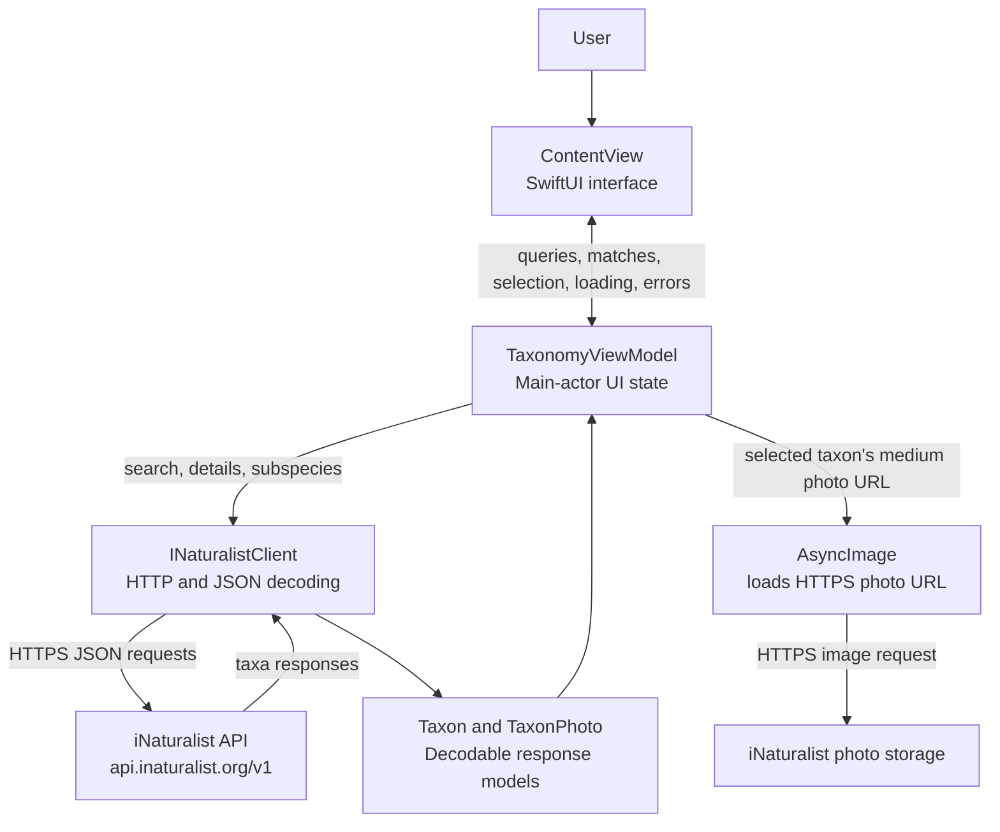
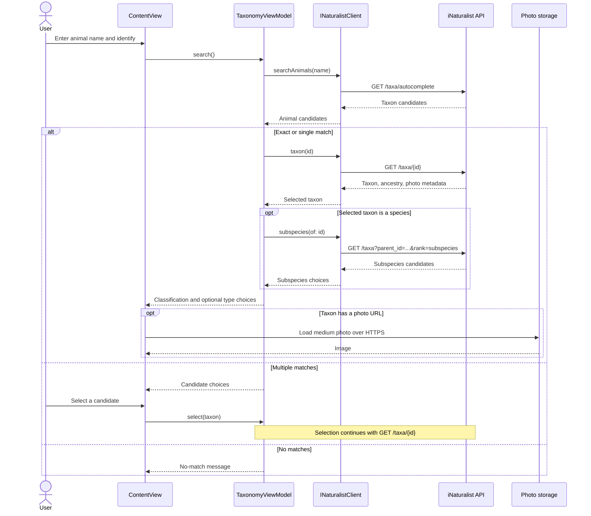
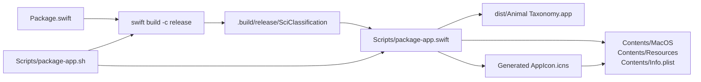

# Architecture

Animal Taxonomy is a native macOS SwiftUI application packaged from a Swift
Package executable. It uses iNaturalist as its taxonomy and animal-photo
source; an internet connection is required for lookups and images.

## Application components



### Responsibilities

- **`ContentView`** renders search, candidate choices, taxonomy ranks, subspecies
  options, and the selected animal's photo. `AsyncImage` displays a loading
  state, a placeholder when the image is unavailable, and the photo attribution
  and iNaturalist source link.
- **`TaxonomyViewModel`** owns observable UI state, filters search results to
  animals, resolves exact and unambiguous matches, and loads subspecies for
  species-level results.
- **`INaturalistClient`** constructs requests to the iNaturalist API, checks
  HTTP status, and decodes taxonomy responses. Request failures are surfaced to
  the view model and shown in the UI.
- **`Taxon`, `TaxonAncestor`, and `TaxonPhoto`** decode taxonomy, rank ancestry,
  and photo metadata. Taxon ancestry supplies the displayed ranks; missing ranks
  are not inferred.

## Lookup flow



## Finder app packaging



The package script builds a release executable, then the AppKit-based packaging
tool creates the `.app` bundle, macOS icon, and `Info.plist`. The `dist/`
directory is generated output and is excluded from Git.

## Project layout

```text
Package.swift
Sources/SciClassification/
  main.swift
  ContentView.swift
  TaxonomyViewModel.swift
  INaturalistClient.swift
  TaxonomyModels.swift
Scripts/
  package-app.sh
  package-app.swift
dist/                         generated app bundle (gitignored)
```
